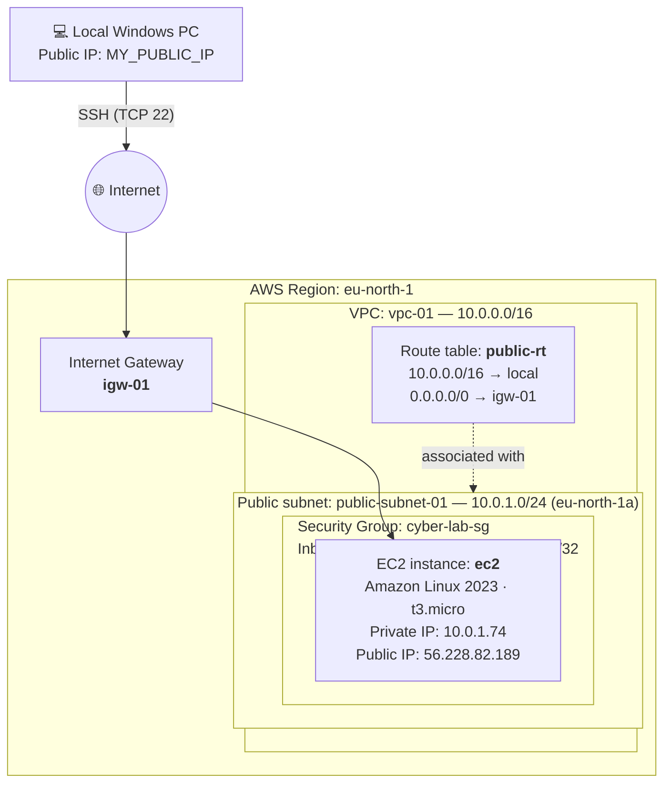
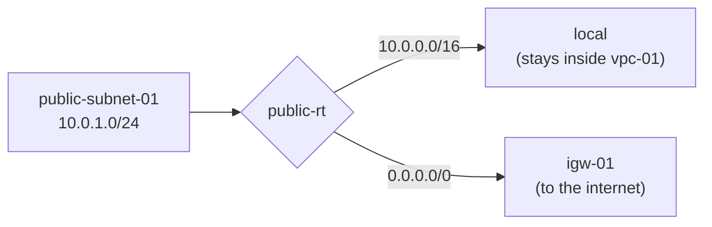
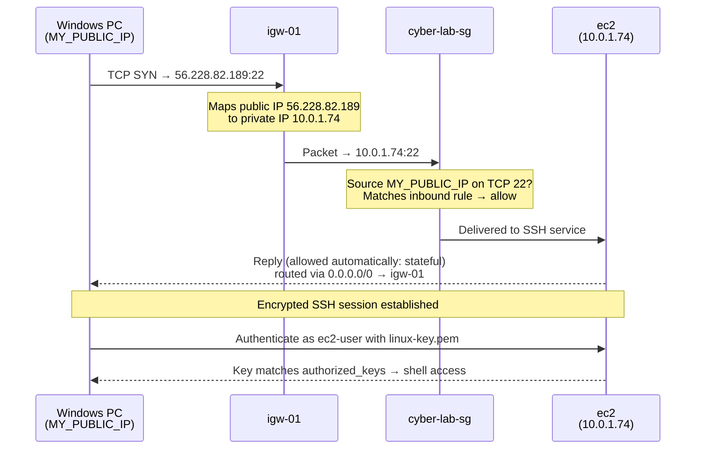

[← Back to all labs](../README.md)

# Lab 01 — VPC, Public Subnet, and EC2 over SSH

A hands-on lab where I built a basic AWS network from scratch, launched a Linux EC2 instance in a public subnet, and connected to it over SSH from my Windows computer.

This is my first AWS networking lab. It's intentionally small: one VPC, one public subnet, one instance. The goal was to understand how the pieces fit together, not to build a production environment.

**Status:** ✅ Completed

| | |
|---|---|
| **AWS Region** | `eu-north-1` (Europe – Stockholm) |
| **Instance OS** | Amazon Linux 2023 |
| **Local machine** | Windows (PowerShell + OpenSSH client) |

---

## Table of contents

1. [Learning objectives](#learning-objectives)
2. [Architecture](#architecture)
3. [Infrastructure and configuration](#infrastructure-and-configuration)
   - [VPC](#vpc)
   - [Internet Gateway](#internet-gateway)
   - [Public subnet](#public-subnet)
   - [Route table](#route-table)
   - [Security Group](#security-group)
   - [EC2 instance](#ec2-instance)
4. [Connecting over SSH from Windows](#connecting-over-ssh-from-windows)
5. [How traffic reaches the instance](#how-traffic-reaches-the-instance)
6. [Security considerations](#security-considerations)
7. [Cost considerations](#cost-considerations)
8. [Next steps](#next-steps)

---

## Learning objectives

- Create a VPC and choose an IP address range for it.
- Connect the VPC to the internet with an Internet Gateway.
- Create a public subnet and route its traffic correctly.
- Restrict inbound access with a Security Group.
- Launch an EC2 instance and understand its networking settings.
- Connect to the instance securely over SSH using a key pair.

---

## Architecture

### Network overview



### Route table



> **Note:** A Security Group isn't a separate network hop like a router. It's a virtual firewall attached to the instance's network interface. It's drawn as a box around the instance to show that every packet reaching the instance is checked against it.

---

## Infrastructure and configuration

### VPC

| Setting | Value |
|---|---|
| Name | `vpc-01` |
| VPC ID | `vpc-0eb1597879a97a4b2` |
| IPv4 CIDR | `10.0.0.0/16` |

**What it is:** A Virtual Private Cloud (VPC) is my own isolated network inside AWS. Nothing gets in or out unless I configure it to.

**Why `10.0.0.0/16`:** `10.0.0.0/8` is a private address range (RFC 1918), so these addresses aren't routable on the public internet. A `/16` gives 65,536 addresses, plenty of room to carve out multiple subnets later (for example, a private subnet).

### Internet Gateway

| Setting | Value |
|---|---|
| Name | `igw-01` |
| Attached to | `vpc-01` |

**What it is:** The Internet Gateway (IGW) is the VPC's connection to the internet. It also performs the translation between an instance's public IPv4 address and its private IPv4 address.

Attaching an IGW alone doesn't make anything public. Traffic only flows through it when:

1. a route table sends traffic to it,
2. the instance has a public IP, and
3. the Security Group allows the traffic.

### Public subnet

| Setting | Value |
|---|---|
| Name | `public-subnet-01` |
| Subnet ID | `subnet-08b55b7b50ee27008` |
| CIDR | `10.0.1.0/24` |
| Availability Zone | `eu-north-1a` |
| Available IPs (reported by AWS) | 251 |

**What it is:** A subnet is a slice of the VPC's address range that lives in a single Availability Zone. This is where the EC2 instance runs.

**Why 251 and not 256?** A `/24` has 256 addresses, but AWS reserves 5 in every subnet:

| Address | Reserved for |
|---|---|
| `10.0.1.0` | Network address |
| `10.0.1.1` | VPC router |
| `10.0.1.2` | DNS server |
| `10.0.1.3` | Reserved by AWS for future use |
| `10.0.1.255` | Broadcast address (not supported, but reserved) |

**What makes it "public"?** Not its name. A subnet is public because its route table has a route to an Internet Gateway (next section).

### Route table

| Setting | Value |
|---|---|
| Name | `public-rt` |
| Associated subnet | `public-subnet-01` (explicit association) |

| Destination | Target | Purpose |
|---|---|---|
| `10.0.0.0/16` | `local` | Communication between resources inside the VPC |
| `0.0.0.0/0` | `igw-01` | Default route: everything else goes to the internet |

**How it works:** For each outgoing packet, AWS picks the most specific matching route:

- A packet to `10.0.1.50` matches `10.0.0.0/16` and stays inside the VPC.
- A packet to my PC's public IP doesn't match `10.0.0.0/16`, so it falls through to `0.0.0.0/0` and is sent to `igw-01`.

**Why the subnet needs this route:** Without the `0.0.0.0/0 → igw-01` route, the instance's replies (like SSH responses) would have nowhere to go. They'd never leave the VPC, even with an IGW attached and a public IP assigned. The route is what turns an ordinary subnet into a public one.

**Why the explicit association matters:** A subnet with no explicit association uses the VPC's *main* route table, which by default only contains the `local` route. I explicitly associated `public-subnet-01` with `public-rt` so it uses the route to the internet.

### Security Group

| Setting | Value |
|---|---|
| Name | `cyber-lab-sg` |
| Security Group ID | `sg-069ad721be15f663d` |
| VPC | `vpc-01` |

**Inbound rules**

| Type | Protocol | Port | Source |
|---|---|---|---|
| SSH | TCP | 22 | `MY_PUBLIC_IP/32` |

> `MY_PUBLIC_IP` stands for my real home public IP address. I left it out of this public write-up on purpose.

**Outbound rules**

| Type | Protocol | Port | Destination |
|---|---|---|---|
| All traffic | All | All | `0.0.0.0/0` (AWS default) |

**What it is:** A Security Group is a virtual firewall attached to an instance's network interface. It only contains *allow* rules. Anything not explicitly allowed inbound is dropped.

**Why it's stateful:** A Security Group tracks connections. When my SSH connection is allowed in on port 22, the return traffic from the instance back to my PC is automatically allowed, without needing a matching outbound rule. (Network ACLs, by contrast, are stateless and need rules in both directions. That's on my list of things to learn next.)

**Why `/32`:** A `/32` CIDR means exactly one IP address. Only my current public IP (`MY_PUBLIC_IP`) can even attempt an SSH connection. Every other address on the internet is dropped before reaching the SSH service.

**Why not `0.0.0.0/0`:** Opening port 22 to `0.0.0.0/0` means *anyone on the internet* can reach the SSH service. Public IPs are scanned constantly by bots that try default usernames, brute-force logins, and probe for SSH vulnerabilities. Key-based authentication makes logging in hard, but there's no reason to expose the service to the whole internet when only one person needs it. Restricting the source shrinks the attack surface.

> **Practical note:** Home internet connections often get a new public IP from the ISP. If that happens, SSH will time out and the inbound rule needs to be updated with the new IP.

> **A mistake I made:** I first created a Security Group named `sg01`, but it was in a *different VPC*. Security Groups belong to a single VPC, so it couldn't be attached to an instance in `vpc-01`. I created `cyber-lab-sg` in the correct VPC instead. `cyber-lab-sg` is the only Security Group used by this instance.

### EC2 instance

| Setting | Value |
|---|---|
| Name | `ec2` |
| Instance ID | `i-021a682b16d2751c2` |
| Instance type | `t3.micro` |
| AMI | Amazon Linux 2023 (`ami-083dedce92603a2ad`) |
| Architecture | 64-bit x86 |
| Key pair | `linux-key` |
| Root volume | 8 GiB, gp3 |
| Credit specification | Standard |
| IMDSv2 | Required |
| Auto-assign public IPv4 | Enabled |
| State | Running (confirmed) |

**Network settings**

| Setting | Value |
|---|---|
| VPC | `vpc-01` |
| Subnet | `public-subnet-01` |
| Private IPv4 | `10.0.1.74` |
| Public IPv4 (at time of verification) | `56.228.82.189` |
| Security Group | `cyber-lab-sg` |

**What EC2 is:** Amazon Elastic Compute Cloud (EC2) provides virtual machines in the cloud. You pick the hardware size (instance type), the operating system image, the network, and the storage.

**What an AMI is:** An Amazon Machine Image (AMI) is a template used to launch an instance. It contains the operating system and its initial configuration. Here, the AMI provides Amazon Linux 2023. AMI IDs are region-specific, so `ami-083dedce92603a2ad` refers to this image in `eu-north-1`.

**Why two IP addresses:**

- **Private IPv4 (`10.0.1.74`)** is the instance's actual address inside the VPC, taken from the subnet's `10.0.1.0/24` range. The operating system only knows about this address.
- **Public IPv4 (`56.228.82.189`)** is the address reachable from the internet. It isn't configured inside the OS. The Internet Gateway maps it to the private IP as traffic passes in and out.

The public IP is auto-assigned and **not permanent**: if the instance is stopped and started again, it will usually get a different one. (An Elastic IP would keep it fixed, but I didn't configure one.)

**Why the username is `ec2-user`:** Each AMI comes with a default login user. For Amazon Linux 2023 it's `ec2-user` (other AMIs use different names, e.g. `ubuntu` on Ubuntu). Password login is disabled by default, so the only way in is with the matching private key.

**Why a key pair is needed:** A key pair is a public/private key pair:

- AWS places the **public key** on the instance (in `~ec2-user/.ssh/authorized_keys`) at launch.
- I keep the **private key** (`linux-key.pem`), which was downloaded once when the key pair was created.

During login, SSH proves I hold the private key without ever sending it over the network. This is much stronger than a password and can't be brute-forced in practice.

---

## Connecting over SSH from Windows

From Windows PowerShell:

```powershell
ssh -i "$env:USERPROFILE\Downloads\linux-key.pem" ec2-user@56.228.82.189
```

| Part | Meaning |
|---|---|
| `ssh` | Starts an encrypted remote shell session (OpenSSH client, built into Windows) |
| `-i "...\linux-key.pem"` | Identity file: the private key used to authenticate |
| `$env:USERPROFILE\Downloads\` | PowerShell shortcut to my user folder's `Downloads` directory |
| `ec2-user` | Default user on Amazon Linux 2023 |
| `56.228.82.189` | The instance's public IPv4 address |

On the first connection, SSH asks to confirm the server's host key fingerprint. Accepting it saves the fingerprint to `known_hosts` so future connections can detect if the server's identity changes.

> If the instance is stopped and started, its public IP will likely change. Check the new one in the EC2 console and update the command.

---

## How traffic reaches the instance



Step by step:

1. **My PC starts the connection.** PowerShell runs `ssh`, which opens a TCP connection to port 22.
2. **The packet targets the public IP** `56.228.82.189` and travels across the internet to AWS.
3. **The Internet Gateway** receives it and translates the destination from the public IP to the instance's private IP, `10.0.1.74`.
4. **The Security Group checks the packet.** The source is `MY_PUBLIC_IP` and the port is TCP 22, which matches the inbound rule, so it's allowed. From any other IP, it would be silently dropped.
5. **The reply goes back out.** The instance responds; the Security Group allows the reply because it's stateful, and `public-rt` sends it to `igw-01` via the `0.0.0.0/0` route.
6. **SSH authenticates me.** Once the encrypted channel is set up, SSH proves I hold the private key matching the public key stored on the instance.
7. **I get a shell** on the Linux machine as `ec2-user`.

### Two different layers of security

| | Security Group | SSH key pair |
|---|---|---|
| **Layer** | Network | Authentication |
| **Question it answers** | *Can this traffic reach the instance at all?* | *Is this person allowed to log in?* |
| **Based on** | Source IP, protocol, port | Possession of the private key |
| **If it fails** | Connection times out | `Permission denied (publickey)` |

They complement each other: even if someone has my IP whitelisted by mistake, they'd still need my private key, and even if my key leaked, an attacker would still need to connect from my IP.

---

## Security considerations

What I implemented:

| Measure | Why it matters |
|---|---|
| **SSH restricted to my IP (`/32`)** | Only one address on the internet can reach port 22, which blocks automated scanning and brute-force attempts. |
| **Key-based SSH authentication** | No passwords to guess; the private key never leaves my machine. |
| **IMDSv2 required** | The Instance Metadata Service (at `169.254.169.254`) can expose instance information and temporary credentials. IMDSv2 requires a session token obtained via a `PUT` request, which protects against attacks like SSRF that trick an application into making simple `GET` requests to the metadata endpoint. |
| **No secrets in this repository** | The private key, AWS credentials, and account ID are not committed. Only resource names, IDs, and network settings are documented. |
| **Standard CPU credit mode** | `t3` instances are burstable. In *Unlimited* mode, sustained CPU usage above the baseline can generate extra charges. *Standard* mode caps bursting once credits run out, so it can't silently increase my bill. This is a cost-control choice more than a security one, but it limits damage if something unexpected (e.g. a runaway process) consumes CPU. |

**Keeping the private key safe:** `linux-key.pem` should stay out of any Git repository. A `.gitignore` entry like `*.pem` is a simple safeguard.

### Limitations

This is a **learning lab, not a hardened production setup.** Things I haven't done include:

- The instance sits in a public subnet with a public IP, rather than in a private subnet behind a bastion host or AWS Systems Manager Session Manager.
- Outbound traffic is unrestricted (`0.0.0.0/0`, the default).
- No Network ACL customization (the VPC's default NACL is in use).
- No logging or monitoring (e.g. VPC Flow Logs, CloudTrail review).
- No IAM role attached to the instance and no OS-level hardening yet.

Several of these are on my [next steps](#next-steps) list.

---

## Cost considerations

This lab **is not automatically free.** Resources that can incur charges:

- **EC2 instance hours:** `t3.micro` is billed while the instance is running.
- **Public IPv4 address:** AWS charges for public IPv4 addresses, including auto-assigned ones, while they're in use.
- **EBS storage:** the 8 GiB gp3 root volume is billed while it exists, *even when the instance is stopped*.
- **Data transfer:** outbound data to the internet can be billed beyond any included allowance.

Free Plan eligibility, credits, and limits depend on the account and change over time, so I check the **Billing and Cost Management** console instead of assuming everything is covered. Setting up an **AWS Budget alert** is a good safeguard.

To avoid ongoing costs when finished:

- **Stop** the instance to stop compute charges (storage is still billed).
- **Terminate** the instance to remove it completely, including the root volume if it's set to delete on termination.

---

## Next steps

These are **planned**, not completed. They'll become future labs (see the [lab index](../README.md#labs)):

- [ ] Validate network connectivity and routing.
- [ ] Compare public and private IP addresses from inside the instance.
- [ ] Test DNS resolution.
- [ ] Explore Security Group behavior (e.g. what happens when a rule is removed).
- [ ] Learn Network ACLs and compare them with Security Groups.
- [ ] Create a private subnet.
- [ ] Explore secure access to private EC2 instances.
- [ ] Study IAM roles and EC2 security hardening.
